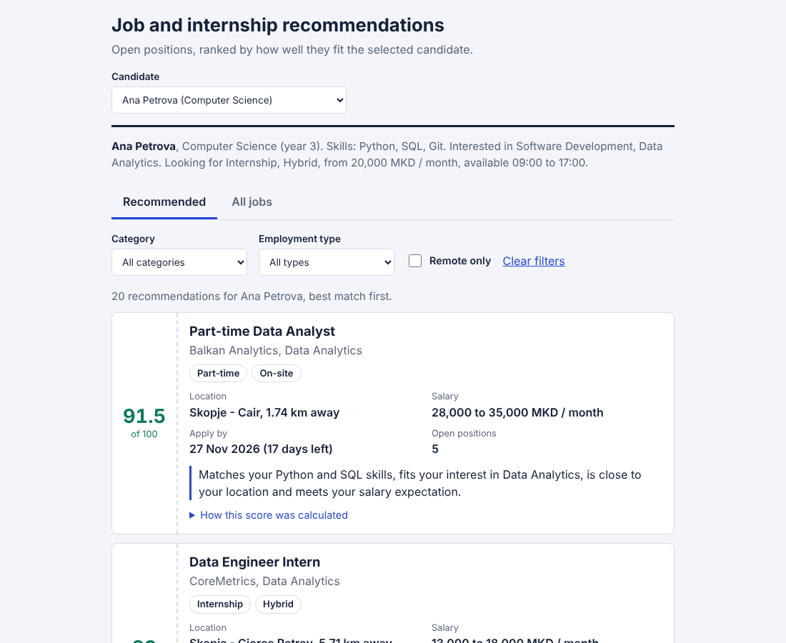
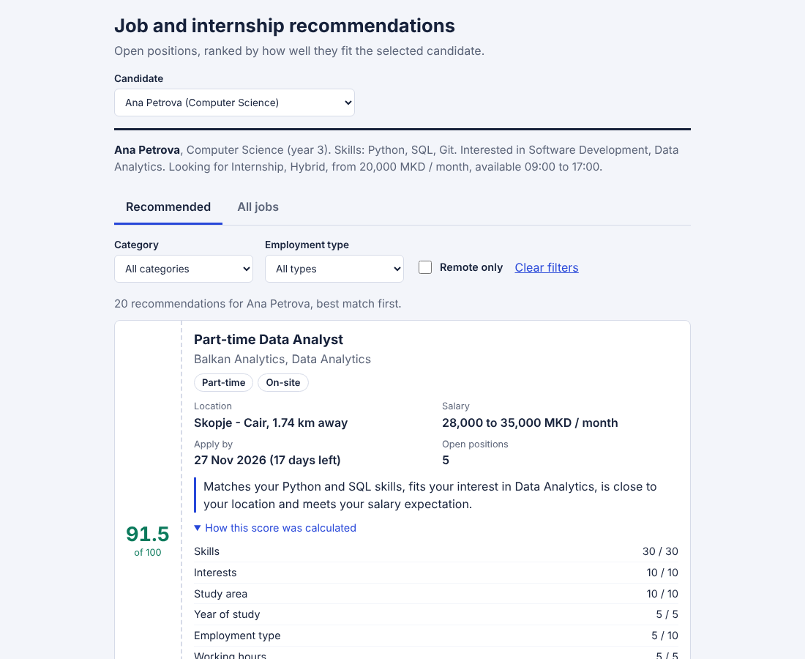
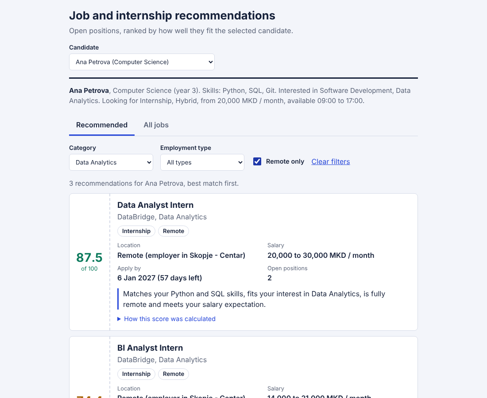
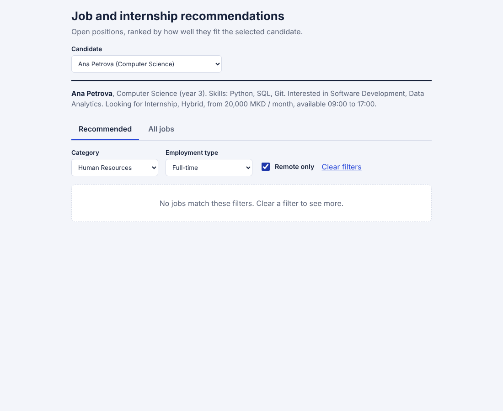
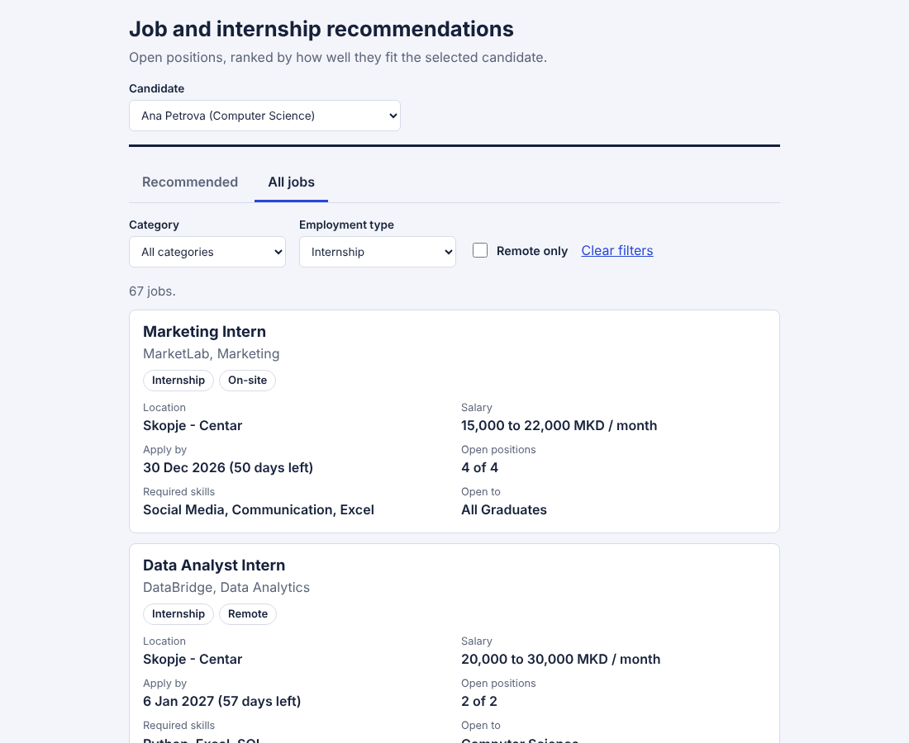
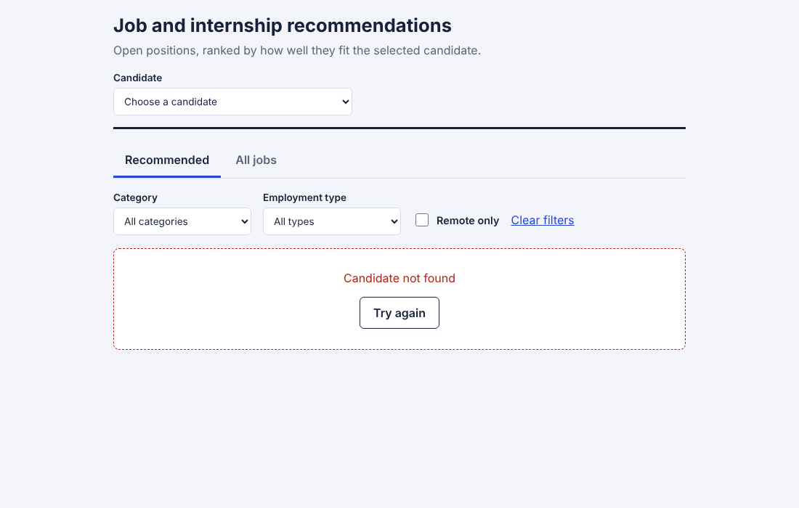
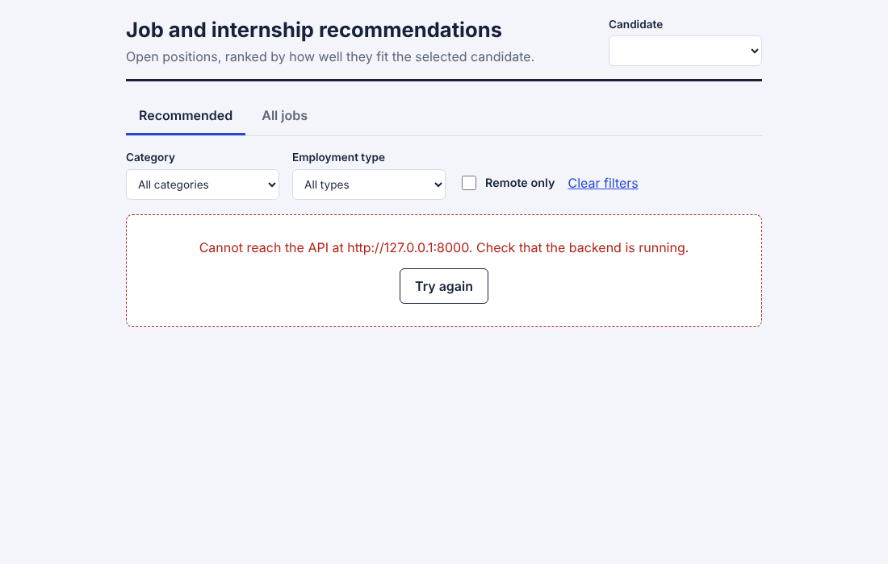
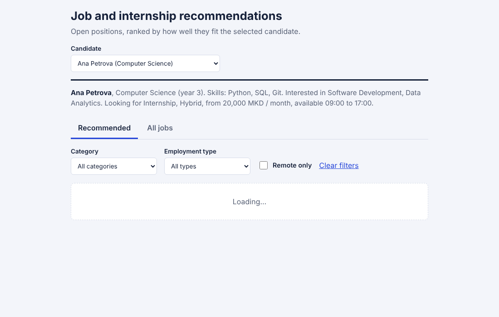
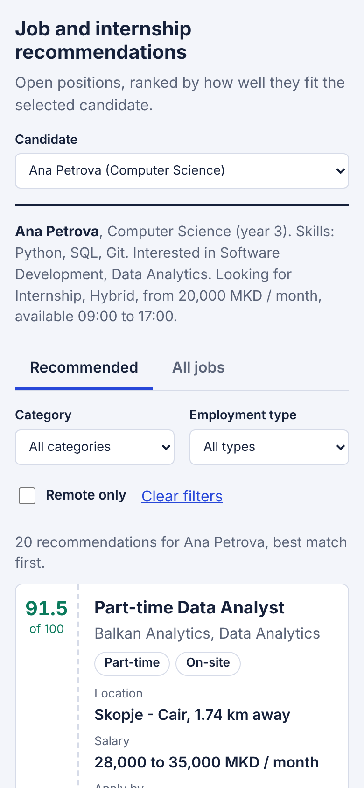

# Testing

The project was tested on three levels: automated tests of the rules and the API,
a check of every endpoint on the running server with PostgreSQL, and a manual check
of the frontend in the browser.

Test run: 10 November 2026, Python 3.13, PostgreSQL 16.

## 1. Automated tests (pytest)

Command: `uv run pytest -v`

Result: **42 passed**

```text
tests/test_api.py::test_create_job_and_read_it_back PASSED
tests/test_api.py::test_unknown_job_returns_404 PASSED
tests/test_api.py::test_invalid_job_is_rejected PASSED
tests/test_api.py::test_job_filters_work_alone_and_together PASSED
tests/test_api.py::test_soft_deleted_job_disappears_from_the_api PASSED
tests/test_api.py::test_create_list_and_get_candidate PASSED
tests/test_api.py::test_candidate_validation PASSED
tests/test_api.py::test_soft_deleted_candidate_disappears_from_the_api PASSED
tests/test_api.py::test_recommendations_for_candidate PASSED
tests/test_api.py::test_recommendations_for_unknown_candidate_returns_404 PASSED
tests/test_api.py::test_recommendations_accept_the_job_filters_and_limit PASSED
tests/test_api.py::test_recommendations_by_location_and_skills PASSED
tests/test_api.py::test_recommendations_by_location_need_all_three_parameters PASSED
tests/test_api.py::test_applying_removes_the_job_from_recommendations PASSED
tests/test_scoring.py::test_haversine_same_point_is_zero PASSED
tests/test_scoring.py::test_haversine_skopje_to_bitola PASSED
tests/test_scoring.py::test_open_job_is_eligible PASSED
tests/test_scoring.py::test_deadline_today_is_still_eligible PASSED
tests/test_scoring.py::test_expired_job_is_not_eligible PASSED
tests/test_scoring.py::test_filled_job_is_not_eligible PASSED
tests/test_scoring.py::test_soft_deleted_job_is_not_eligible PASSED
tests/test_scoring.py::test_skills_fraction_counts_matching_skills PASSED
tests/test_scoring.py::test_interests_fraction PASSED
tests/test_scoring.py::test_audience_fraction PASSED
tests/test_scoring.py::test_year_of_study_fraction PASSED
tests/test_scoring.py::test_employment_type_fraction PASSED
tests/test_scoring.py::test_schedule_fraction_is_the_share_of_covered_working_hours PASSED
tests/test_scoring.py::test_work_mode_fraction PASSED
tests/test_scoring.py::test_distance_fraction PASSED
tests/test_scoring.py::test_remote_job_has_no_distance_and_full_distance_points PASSED
tests/test_scoring.py::test_salary_fraction PASSED
tests/test_scoring.py::test_availability_fraction PASSED
tests/test_scoring.py::test_weights_add_up_to_100 PASSED
tests/test_scoring.py::test_perfect_match_scores_100 PASSED
tests/test_scoring.py::test_score_is_the_sum_of_the_breakdown PASSED
tests/test_scoring.py::test_same_input_gives_the_same_score PASSED
tests/test_scoring.py::test_visitor_with_only_location_and_skills_uses_three_criteria PASSED
tests/test_scoring.py::test_reason_mentions_matched_skills PASSED
tests/test_scoring.py::test_job_without_matching_skills_is_kept_but_explained PASSED
tests/test_scoring.py::test_recommend_removes_closed_jobs_and_sorts_by_score PASSED
tests/test_scoring.py::test_ties_are_broken_by_deadline_and_then_by_id PASSED
tests/test_scoring.py::test_limit_cuts_the_list PASSED

============================== 42 passed in 0.54s ==============================
```

What the tests cover:

| Area | Checked |
|---|---|
| Scoring rules | each of the ten criteria, the Haversine formula, the weights add up to 100 |
| Special cases | expired, filled and soft-deleted jobs, missing salary, remote jobs, no matching skills, visitor without a profile |
| Ranking | sorted by score, ties broken by deadline and id, `limit`, the same input gives the same result |
| Endpoints | all eight required endpoints, status codes 201, 404, 409 and 422 |
| Filters | category, employment type and remote only, alone and combined |

## 2. Data cleaning

Command: `uv run python -m scripts.clean_data`

```text
Jobs:       150 clean, 9 rejected
  - job_id 151: duplicate of job_id 5
  - job_id 152: duplicate of job_id 20
  - job_id 153: missing title
  - job_id 154: latitude is out of range
  - job_id 155: invalid application_deadline
  - job_id 156: unknown employment_type
  - job_id 157: vacancies must be at least 1
  - job_id 158: no required_skills
  - job_id 159: longitude is not a number
Candidates: 80 clean, 0 rejected
```

## 3. API on the running server with PostgreSQL

Command: `uv run python -m scripts.smoke_test` (the API was running with the seeded database)

```text
[PASS] GET /jobs  (150 jobs)
[PASS] GET /jobs?category=Software Development  (23 jobs)
[PASS] GET /jobs?employment_type=Internship  (67 jobs)
[PASS] GET /jobs?remote_only=true  (32 jobs)
[PASS] GET /jobs with all three filters  (1 jobs)
[PASS] GET /jobs/1
[PASS] GET /jobs/999999 returns 404
[PASS] GET /candidates  (80 candidates)
[PASS] GET /candidates/1
[PASS] GET /candidates/999999 returns 404
[PASS] GET /recommendations/1  (20 recommendations, best score 91.5)
[PASS]   sorted from highest to lowest score
[PASS]   no expired or filled jobs
[PASS] GET /recommendations/999999 returns 404
[PASS] GET /recommendations?lat=...&lon=...&skills=...
[PASS] POST /jobs  (status 201)
[PASS] POST /jobs with invalid data returns 422
[PASS] POST /candidates  (status 201)

All checks passed.
```

## 4. Frontend

Checked in Chromium at a desktop width (1100 px) and a phone width (390 px).

| Check | Result |
|---|---|
| `index.html?candidate_id=1` loads the recommendations of candidate 1 | OK |
| Changing the candidate reloads the cards and updates the address | OK |
| Category, employment type and remote-only filters, alone and combined | OK |
| "Clear filters" shows the full list again | OK |
| "All jobs" view uses the same filters and marks closed jobs | OK |
| Loading state while the request is running | OK |
| Empty state when no job matches the filters | OK |
| Error state for an unknown candidate (`candidate_id=9999`) | OK |
| Error state when the API is not reachable | OK |
| No horizontal scrolling at 390 px | OK |
| Page also works when opened directly from disk (`file://`) | OK |

### Screenshots

Recommendations for candidate 1:



Score breakdown on a card:



Recommendations with two filters (Data Analytics, remote only):



Empty state:



All jobs filtered by employment type:



Error state, unknown candidate:



Error state, API not reachable:



Loading state:



Phone screen (390 px):


